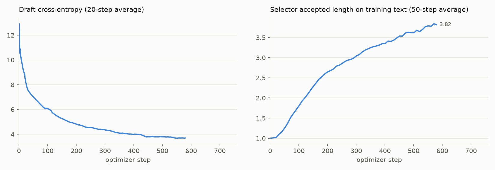

# DFlash2 Speculative-Decoding Draft

Train a [DFlash2](https://github.com/sgl-project/SpecForge) draft model for a target LLM on Cortex Training.
The result is a weights-only checkpoint in the Hugging Face layout (`config.json` + `model.safetensors`) that a sampling sub-job serves with `speculative_config.method = "dflash"`.

## Defaults

| | |
|---|---|
| Target | `Qwen/Qwen3.5-4B` |
| Draft | `drafts/qwen3.5-4b.json`: 5 layers, hidden size 2560, block size 16, convolution 2x16, selector rank 256 / top-16, target layers 1, 8, 15, 22, 29|
| Data | conversations written by the target itself, `data_path=` (see [Data](#data)) |
| Training | 4 GPUs, 64 conversations of up to 3072 tokens per step, AdamW at a peak lr of 6e-4 (4% warmup, then cosine), clip 1.0, 512 anchors per sequence |
| Serving | 1 GPU, 4096-token context, 15 speculative tokens |

## Data

**Train on text the target wrote.** 
`generate_data.py` starts the target's catalog inference endpoint (8 GPUs for Qwen3.5-4B), takes the first 16,000 conversations of
[UltraChat](https://huggingface.co/datasets/HuggingFaceH4/ultrachat_200k) (`train_sft`), and answers every user turn
again with the target, one turn at a time, thinking on:

```bash
python -m recipes.dflash2.generate_data config=/path/to/config.json out_dir=/path/to/data
# writes regenerated.jsonl (every kept conversation), train.jsonl and heldout.jsonl
```

`data/sample.jsonl` holds 16 such conversations for smoke runs. It is too small to train a useful draft.

## Run

Write the data (above), then train for 580 steps, save every 100, and serve the final draft and measure its
acceptance on 128 held-out prompts. On 4 H200 GPUs training takes about 70 minutes:

```bash
python -m recipes.dflash2.train config=/path/to/config.json \
  data_path=/path/to/data/train.jsonl max_steps=580 save_every=100 \
  eval_prompts=/path/to/data/heldout.jsonl
```

Each save logs `draft_job_id=... draft_checkpoint_id=cp_...`. The checkpoints stay on the job's stage after the
training job ends, so you can measure any of them later, on an endpoint the script starts and stops
(`keep_job=true` leaves it running), or on a running one (`job_id=`):

```bash
python -m recipes.dflash2.evaluate config=/path/to/config.json prompts=heldout.jsonl \
  draft_job_id=TRAINING_JOB_ID draft_checkpoint_id=cp_...
```

A smoke run of the whole path, two steps on the bundled sample:

```bash
python -m recipes.dflash2.train config=/path/to/config.json \
  data_path=recipes/dflash2/data/sample.jsonl max_steps=2 train_batch_size=8 \
  eval_prompts=recipes/dflash2/data/sample.jsonl eval_num_prompts=8 eval_max_tokens=128
```

See [Run an example](../README.md#run-an-example) for the connection arguments.

## Results

The example ran end to end on Cortex Training: `generate_data.py` (25 minutes on 8 H200 GPUs), then `train.py` for
580 steps of 64 conversations (63 minutes on 4 H200 GPUs), then serving and measuring the final draft.



Served mean acceptance length of the final draft, greedy, 128 prompts of up to 1024 new tokens, served on Cortex
Training by `evaluate.py`:

|                  | Mean acceptance length |
|------------------|------------------------|
| Our reproduction | 2.65                   |
| SpecForge        | 2.67                   |

The training set is small and multi-turn (about 7,000 usable conversations), so absolute acceptance is well below what
a production-sized, single-turn corpus gives.

