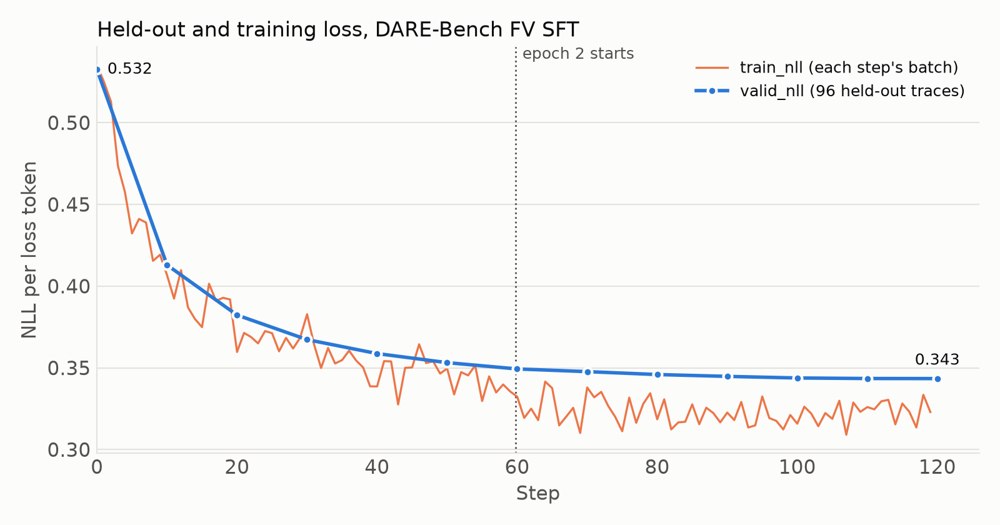

# DARE-Bench Data-Science Agent SFT

Fine-tune Qwen3-8B on DARE-Bench's agent traces, then score it on the
benchmark's eval split with a local agent loop.

## DARE-Bench

[DARE-Bench](https://github.com/Snowflake-Labs/dare-bench) (Shu et al., ICLR
2026) tests LLMs as data-science agents. Each task is built from a Kaggle
dataset: the agent reads the task, writes Python that runs in a sandbox through
a `python_executor` tool, and must leave its predictions in `prediction.csv`.
The public release, a subset of the paper's 6,300 tasks, has 162 eval tasks,
each in two variants (324 episodes):

| Task type | `v1` variant | `v2` variant |
|---|---|---|
| Classification (68 tasks) | Instruction following (IF): follow a specified pipeline; exact match against a reference prediction | ML modeling (MM): build the best model it can; macro-F1 |
| Regression (42 tasks) | IF; exact match | MM; R² clipped to [0, 1] |
| Time series (52 tasks) | Forecasting with exogenous features (XF); clipped R² | Canonical forecasting (CF); clipped R² |

For training, the
[`Snowflake/dare-bench`](https://huggingface.co/datasets/Snowflake/dare-bench)
dataset ships rejection-sampled multi-turn agent traces in the OpenAI chat
format, under four filters: the fastest valid trace per training task (FV), all
valid traces (AV), and the best one (BV) or two (DV) valid traces from a more
diverse subset of tasks.

## Results

About two epochs of full-parameter SFT on the FV traces (120 steps of 32, 3,840
examples) nearly triple the total score:

| Model | Total | class-IF | class-MM | reg-IF | reg-MM | time-XF | time-CF | Wrote a prediction |
|---|---|---|---|---|---|---|---|---|
| Qwen3-8B, no fine-tuning | 10.13 | 5.88 | 16.77 | 7.14 | 19.13 | 12.24 | 0.00 | 29.3% |
| Full SFT, default settings (1,912 FV traces, 120 steps) | **29.34** | 20.59 | 31.10 | 50.00 | 46.54 | 37.26 | 0.00 | 39.8% |

Held-out loss (`valid_nll`) over the same run:



## Setup

```bash
# 0. Scoring dependencies, in the environment that runs the example scoring
uv pip install pandas scikit-learn

# 1. Eval tasks
git clone https://github.com/Snowflake-Labs/dare-bench
cd dare-bench && git checkout 01447145304c67b861a004ada6d86f29640de61a && cd ..
BENCH_DIR=$PWD/dare-bench/data/eval

# 2. Sandbox environment for model-written code (versions used for the results)
uv venv --python 3.12 dare_sandbox_env
VIRTUAL_ENV=$PWD/dare_sandbox_env uv pip install \
  pandas==2.2.3 numpy==2.2.6 scikit-learn==1.6.1 scipy pyarrow joblib \
  xgboost lightgbm statsmodels

# 3. Reference predictions for the IF variants (simulated_pred_local.csv).
#    Use absolute paths; the script resolves them relative to each task.
dare_sandbox_env/bin/python dare-bench/scripts/reference_solution.py \
  --databases_dir $BENCH_DIR/databases \
  --question_list $BENCH_DIR/question_list.json \
  --output_dir /tmp/dare-ref --execute
```

Step 3 should report 110 successes (the classification and regression tasks;
the 52 time-series tasks are skipped because they ship their own ground truth).
The evaluator refuses to start if a reference file is missing.

## Run

Training defaults to full-parameter Qwen3-8B at standard context on eight H200
GPUs, with `lr=1e-5`, `train_batch_size=32`, a cosine schedule, thinking on,
and 120 steps, logging `valid_nll` every 10 steps (`eval_every=`). It takes the
same job arguments as the [conversational SFT example](../README.md#options);
run it with `--help` for the full list. Evaluation serves the model on two GPUs.

The GPU count comes from [`overrides.json`](overrides.json), which sets
`n_gpus` to 8 for every catalog-built DARE run, whatever `model=` you pick. It
also drops the `ds_config` batch fields some catalog files spell out for their
own GPU count, so the server derives them for 8 GPUs.
A model whose catalog `sp_size` or `ep_size` does not divide 8 (GLM-5.3-Flash-BF16
uses 16) stops with an error before anything is submitted; edit that file or
pass `job_config=` for it.

```bash
# 1. Baseline
python -m recipes.sft_quickstart.dare.evaluate \
  config=/path/to/config.json \
  bench_dir=$BENCH_DIR \
  sandbox_python=$PWD/dare_sandbox_env/bin/python \
  log_path=/tmp/dare/base

# 2. Train (prints the step-3 command, with the job and checkpoint IDs, when it finishes)
python -m recipes.sft_quickstart.dare.train \
  config=/path/to/config.json

# 3. Score the checkpoint
python -m recipes.sft_quickstart.dare.evaluate \
  config=/path/to/config.json \
  bench_dir=$BENCH_DIR \
  sandbox_python=$PWD/dare_sandbox_env/bin/python \
  source_job_id=TRAINING_JOB_ID \
  checkpoint_id=CHECKPOINT_ID \
  log_path=/tmp/dare/sft
```

The evaluator writes `predictions.jsonl` (per-episode score, stop reason, tool
call count, and the full conversation) and `metrics.jsonl` under `log_path`.
Work directories with each episode's outputs are kept under `log_path/work`.

**Model-written code runs on the evaluator's machine** by default, as a local
subprocess with a stripped environment, not inside a container. Run the
evaluator where that is acceptable, or use `sandbox_url=` (see
[Evaluation details](#evaluation-details)). Up to 32 sandboxes run at a time
(`sandbox_workers=`), each limited to 4 BLAS/OpenMP threads.

## Data

- **Training traces**: `sft_data/sft_data_fv.json` from
  [`Snowflake/dare-bench`](https://huggingface.co/datasets/Snowflake/dare-bench),
  downloaded on first use: the 2,017 successful traces that pass the FV filter.
  `variant=av|bv|dv` selects the other filters.
- **Held-out traces**: the dataset ships no validation split, so training holds
  out every trace of 5% of the task ids (`heldout_fraction`).
- **Eval tasks**: the `data/eval` directory of the
  [Snowflake-Labs/dare-bench](https://github.com/Snowflake-Labs/dare-bench)
  repository.

Training renders the `python_executor` schema into the system turn exactly as
the traces were generated and puts loss on every assistant turn, reasoning
included (thinking on), matching what the `Qwen3` chat template produces inside
a tool loop and what the agent loop below feeds back to the model.

## Evaluation Details

`evaluate.py` runs the public harness's own tool, dispatch, and scoring code,
copied into `dare_bench/`, inside a local agent loop:

- The model gets the task prompt and the tool, and has up to 5 assistant
  turns; every tool call in a turn is run, so a turn can run several. Each call goes through DARE-Bench's `python_executor`. It sends the code and
  the requested input files with a 200-second limit, and copies the requested
  output files back to the task's work directory.
- By default that endpoint is a local server (`sandbox.py`) that runs each call
  as one fresh Python process under `sandbox_python`. Pass `sandbox_url` to use
  a [Sandbox Fusion](https://bytedance.github.io/SandboxFusion/) deployment, as
  the public harness does.
- Decoding is greedy with thinking on, up to 16,384 new tokens per turn. An
  episode ends when the model answers without a tool call, runs out of turns, or
  its prompt reaches the endpoint's 32,768-token limit.
- The final `prediction.csv` is scored against the task's reference with
  DARE-Bench's `evaluation.py`.

